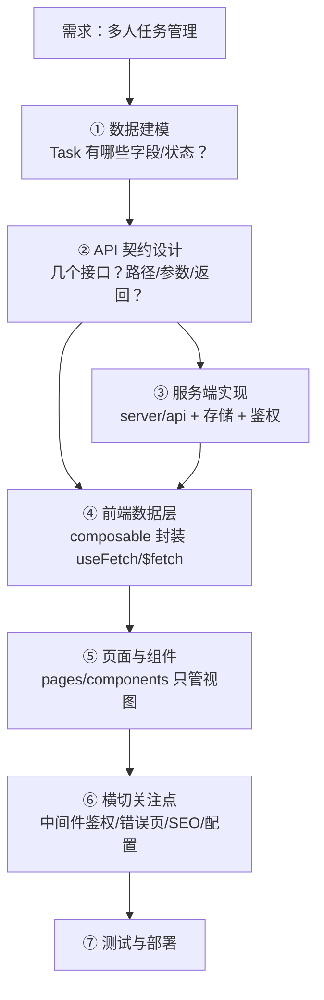
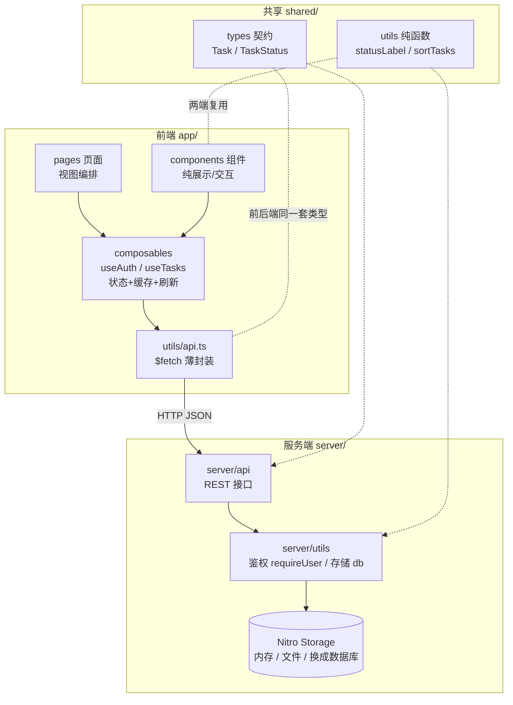

# Nuxt 4 实战：TaskFlow 全栈任务管理应用

> [!abstract] 这个 Demo 练什么
> 一个带**登录鉴权 + 任务 CRUD + 筛选搜索 + 错误处理 + SEO/渲染策略**的全栈应用。
> **重点不是"任务管理"本身，而是掌握 Nuxt 项目架构和全栈开发逻辑**：
> 拿到任何需求 → 先设计什么 → 目录怎么规划 → 代码分层怎么落 → 最后怎么交付。

---

# 一、先想清楚再动手：全栈开发逻辑

## 1.1 拿到需求后的思考链路



> [!tip] 核心思想：**契约先行 + 分层收口**
> - 先定 `shared/types`（前后端共用同一套类型），接口没写，"合同"已经签了
> - 前端页面**永远不直接散落 `$fetch`**，统一收口到 composable；composable 也只做数据编排，HTTP 细节在 API 层
> - 这样每一层都能独立替换：换 UI 库不动数据层，换数据库不动前端

## 1.2 项目分层架构图



## 1.3 目标目录树（先看全貌，下面逐步实现）

```bash
taskflow/
├── app/
│   ├── app.vue                     # 根：Layout + Page + 全局标题模板
│   ├── error.vue                   # 全局错误页
│   ├── assets/css/main.css         # 全局样式
│   ├── components/
│   │   ├── TaskCard.vue            # 任务卡片
│   │   ├── TaskForm.vue            # 新建任务表单
│   │   └── StatusBadge.vue         # 状态徽章
│   ├── composables/
│   │   ├── useAuth.ts              # 登录态：登录/登出/当前用户
│   │   ├── useTasks.ts             # 列表：筛选+CRUD+自动刷新
│   │   └── useTask.ts              # 详情：单个任务读取+保存
│   ├── layouts/default.vue         # 导航栏 + 页脚
│   ├── middleware/auth.global.ts   # 全局路由守卫（/tasks 需登录）
│   ├── pages/
│   │   ├── index.vue               # 营销首页（prerender）
│   │   ├── login.vue               # 登录页
│   │   └── tasks/
│   │       ├── index.vue           # 任务列表（主战场）
│   │       └── [id].vue            # 任务详情/编辑（动态路由）
│   └── utils/api.ts                # $fetch 薄封装（API 层）
├── server/
│   ├── api/
│   │   ├── auth/login.post.ts      # 登录（写 cookie）
│   │   ├── auth/me.get.ts          # 当前用户
│   │   ├── auth/logout.post.ts     # 登出
│   │   └── tasks/
│   │       ├── index.get.ts        # 列表（支持 status/q 筛选）
│   │       ├── index.post.ts       # 新建
│   │       └── [id]/{get,patch,delete}.ts
│   └── utils/
│       ├── auth.ts                 # requireUser / cookie 读取
│       └── db.ts                   # 基于 useStorage 的数据访问
├── shared/                         # ★ 前后端共享
│   ├── types/task.ts               # Task / TaskInput / TaskStatus
│   └── utils/
│       ├── task.ts                 # statusLabel / sortTasks（两端复用）
│       └── constants.ts            # SESSION_COOKIE 常量（两端复用）
├── public/favicon.ico
├── nuxt.config.ts
└── package.json
```

> [!note] 存储选择
> Demo 用 **Nitro `useStorage`**（默认内存，可挂文件驱动），**零依赖跑通全栈闭环**；真实项目把 `server/utils/db.ts` 换成 Drizzle/Prisma 即可，其他层一行不改——这就是分层的价值。

---

# 二、Step 0：项目初始化

```bash
npm create nuxt@latest taskflow
# 包管理器：npm；git：Yes；模块：先不装
cd taskflow && npm run dev -- -o
```

清理模板：删除 `app/app.vue` 里的欢迎内容，删掉示例组件（如有）。此时 `app/` 下只需要一个空的 `app.vue`。

```vue [app/app.vue]
<template>
  <div>Nuxt 4 就绪 ✅</div>
</template>
```

> [!todo] 这一步在练什么
> 验证环境；记住 **没有 `pages/` 目录时 `app.vue` 就是整站**——创建 `pages/` 后路由系统才启动。

---

# 三、Step 1：数据建模（shared/types）

先不写一行业务代码，先回答：**一条任务长什么样？**

```ts [shared/types/task.ts]
export type TaskStatus = 'todo' | 'doing' | 'done'

export interface Task {
  id: string
  title: string
  notes?: string
  status: TaskStatus
  createdAt: string   // ISO 字符串：可 JSON 序列化，符合 useState/payload 约束
}

/** 新建/更新的输入（POST / PATCH 的 body 契约） */
export interface TaskInput {
  title: string
  notes?: string
  status?: TaskStatus
}
```

```ts [shared/utils/task.ts]
import type { Task, TaskStatus } from '#shared/types/task'

export const TASK_STATUSES: TaskStatus[] = ['todo', 'doing', 'done']

const LABELS: Record<TaskStatus, string> = {
  todo: '待办',
  doing: '进行中',
  done: '已完成',
}

/** 状态 → 中文标签：组件徽章用、server 校验也用 */
export function statusLabel(status: TaskStatus): string {
  return LABELS[status] ?? status
}

/** 统一排序：进行中 > 待办 > 已完成，同状态按创建时间倒序 —— server 输出前排一次 */
export function sortTasks(tasks: Task[]): Task[] {
  const order: Record<TaskStatus, number> = { doing: 0, todo: 1, done: 2 }
  return [...tasks].sort(
    (a, b) => order[a.status] - order[b.status] || b.createdAt.localeCompare(a.createdAt),
  )
}
```

```ts [shared/utils/constants.ts]
/** 会话 cookie 名：server 写、前端中间件读，必须同一处定义 */
export const SESSION_COOKIE = 'tf_session'
```

> [!todo] 这一步在练什么
> - **契约先行**：类型放 `shared/`，前端 `import type { Task } from '#shared/types/task'`，server 同理——改字段时两端同时类型报错，而不是运行时炸
> - **纯函数下沉**：`statusLabel`/`sortTasks` 两端都要用（UI 显示 / API 输出统一），这正是 Nuxt 4 `shared/` 目录存在的意义
> - `shared/types/` 与 `shared/utils/` 在两端都是**自动导入**的（本文显式写 import 是为了教学清晰）

---

# 四、Step 2：API 契约设计

类型定了，接口长什么样？**先在纸/表格上签合同，再写代码**：

| 方法 | 路径 | 说明 | 请求体 | 返回 | 鉴权 |
| ---- | ---- | ---- | ---- | ---- | ---- |
| POST | `/api/auth/login` | 登录（写 cookie） | `{ name }` | `{ name }` | - |
| GET | `/api/auth/me` | 当前用户 | - | `{ user: string \| null }` | - |
| POST | `/api/auth/logout` | 登出（清 cookie） | - | `{ ok: true }` | - |
| GET | `/api/tasks` | 列表 | `?status=todo\|doing\|done&q=关键词` | `Task[]` | ✅ |
| POST | `/api/tasks` | 新建 | `TaskInput` | `Task` | ✅ |
| GET | `/api/tasks/:id` | 详情 | - | `Task` | ✅ |
| PATCH | `/api/tasks/:id` | 局部更新 | `Partial<TaskInput>` | `Task` | ✅ |
| DELETE | `/api/tasks/:id` | 删除 | - | `{ ok: true }` | ✅ |

设计原则：RESTful 命名；错误统一 `createError` 返回 `400/401/404`；列表接口带**筛选参数**（服务端过滤，前端只管传参）。

---

# 五、Step 3：实现服务端（Nitro）

## 3.1 数据访问层 `server/utils/db.ts`

`server/utils/` **自动导入**到所有 server 文件——所以这里不放路由，只放"数据访问"这种被复用的底层。

```ts [server/utils/db.ts]
import type { Task } from '#shared/types/task'
import { sortTasks } from '#shared/utils/task'

const SEED: Task[] = [
  { id: 'seed-1', title: '体验 TaskFlow', notes: '第一条任务', status: 'doing', createdAt: '2026-01-01T08:00:00.000Z' },
  { id: 'seed-2', title: '把状态改成已完成试试', status: 'todo', createdAt: '2026-01-01T09:00:00.000Z' },
  { id: 'seed-3', title: '欢迎来到 Nuxt 4 全栈世界', status: 'done', createdAt: '2026-01-01T07:00:00.000Z' },
]

// 每个用户一份任务：key 规则 tasks:<user>
const userKey = (user: string) => `tasks:${user}`

async function readTasks(user: string): Promise<Task[]> {
  const storage = useStorage('data')
  let tasks = await storage.get<Task[]>(userKey(user))
  if (!tasks) {
    tasks = structuredClone(SEED)     // 首次访问播种演示数据
    await storage.set(userKey(user), tasks)
  }
  return tasks
}

async function writeTasks(user: string, tasks: Task[]) {
  await useStorage('data').set(userKey(user), tasks)
}

/** 对外只暴露"读写 + 排序保证"三个原语，路由层不碰 storage 细节 */
export async function listTasks(user: string): Promise<Task[]> {
  return sortTasks(await readTasks(user))
}

export async function saveTasks(user: string, tasks: Task[]) {
  await writeTasks(user, tasks)
}

export function createId(): string {
  return crypto.randomUUID()
}
```

> [!todo] 这一步在练什么
> **db.ts 是未来换数据库的唯一修改点。** 换 Drizzle 时只需重写这三个函数签名不变的实现，所有 API 路由零改动。

## 3.2 鉴权工具 `server/utils/auth.ts`

```ts [server/utils/auth.ts]
import type { H3Event } from 'h3'
import { SESSION_COOKIE } from '#shared/utils/constants'

/** 读取当前登录用户（没有则 null）——不抛错，供 /me 等接口用 */
export function getSessionUser(event: H3Event): string | null {
  return getCookie(event, SESSION_COOKIE) ?? null
}

/** 强制登录——抛 401，供 tasks 系列接口用 */
export function requireUser(event: H3Event): string {
  const user = getSessionUser(event)
  if (!user) {
    throw createError({ statusCode: 401, statusMessage: 'Unauthorized', message: '请先登录' })
  }
  return user
}
```

## 3.3 认证接口

```ts [server/api/auth/login.post.ts]
export default defineEventHandler(async (event) => {
  const body = await readBody<{ name?: string }>(event)
  const name = body?.name?.trim()
  if (!name) {
    throw createError({ statusCode: 400, statusMessage: 'Bad Request', message: '用户名不能为空' })
  }
  // ⚠️ Demo 简化：cookie 直接存用户名、非 httpOnly。
  // 真实项目：签发签名 session/JWT、httpOnly:true，见本笔记末尾"迁移真实项目"。
  setCookie(event, SESSION_COOKIE, name, {
    path: '/',
    sameSite: 'lax',
    maxAge: 60 * 60 * 24 * 7,   // 7 天
  })
  return { name }
})
```

```ts [server/api/auth/me.get.ts]
export default defineEventHandler((event) => {
  return { user: getSessionUser(event) }
})
```

```ts [server/api/auth/logout.post.ts]
export default defineEventHandler((event) => {
  deleteCookie(event, SESSION_COOKIE, { path: '/' })
  return { ok: true }
})
```

## 3.4 任务 CRUD 接口

```ts [server/api/tasks/index.get.ts]
export default defineEventHandler(async (event) => {
  const user = requireUser(event)
  const { status, q } = getQuery(event)

  let tasks = await listTasks(user)
  if (typeof status === 'string' && status !== 'all') {
    tasks = tasks.filter((t) => t.status === status)
  }
  if (typeof q === 'string' && q.trim()) {
    const kw = q.trim().toLowerCase()
    tasks = tasks.filter(
      (t) => t.title.toLowerCase().includes(kw) || t.notes?.toLowerCase().includes(kw),
    )
  }
  return tasks
})
```

```ts [server/api/tasks/index.post.ts]
import type { Task, TaskInput } from '#shared/types/task'

export default defineEventHandler(async (event) => {
  const user = requireUser(event)
  const body = await readBody<TaskInput>(event)

  const title = body?.title?.trim()
  if (!title) {
    throw createError({ statusCode: 400, statusMessage: 'Bad Request', message: '标题不能为空' })
  }

  const tasks = await listTasks(user)
  const task: Task = {
    id: createId(),
    title,
    notes: body.notes?.trim() || undefined,
    status: body.status ?? 'todo',
    createdAt: new Date().toISOString(),
  }
  tasks.push(task)
  await saveTasks(user, tasks)
  return task
})
```

```ts [server/api/tasks/[id].get.ts]
export default defineEventHandler(async (event) => {
  const user = requireUser(event)
  const id = getRouterParam(event, 'id')

  const task = (await listTasks(user)).find((t) => t.id === id)
  if (!task) {
    throw createError({ statusCode: 404, statusMessage: 'Not Found', message: '任务不存在' })
  }
  return task
})
```

```ts [server/api/tasks/[id].patch.ts]
import type { TaskInput } from '#shared/types/task'

export default defineEventHandler(async (event) => {
  const user = requireUser(event)
  const id = getRouterParam(event, 'id')
  const patch = await readBody<Partial<TaskInput>>(event)

  const tasks = await listTasks(user)
  const task = tasks.find((t) => t.id === id)
  if (!task) {
    throw createError({ statusCode: 404, statusMessage: 'Not Found', message: '任务不存在' })
  }

  if (patch.title !== undefined) {
    const title = patch.title.trim()
    if (!title) {
      throw createError({ statusCode: 400, statusMessage: 'Bad Request', message: '标题不能为空' })
    }
    task.title = title
  }
  if (patch.notes !== undefined) task.notes = patch.notes.trim() || undefined
  if (patch.status !== undefined) task.status = patch.status

  await saveTasks(user, tasks)
  return task
})
```

```ts [server/api/tasks/[id].delete.ts]
export default defineEventHandler(async (event) => {
  const user = requireUser(event)
  const id = getRouterParam(event, 'id')

  const tasks = await listTasks(user)
  const next = tasks.filter((t) => t.id !== id)
  if (next.length === tasks.length) {
    throw createError({ statusCode: 404, statusMessage: 'Not Found', message: '任务不存在' })
  }
  await saveTasks(user, next)
  return { ok: true }
})
```

> [!todo] 这一步在练什么
> - 文件名即路由：`tasks/index.get.ts`、`tasks/[id].patch.ts`
> - `server/utils` 自动导入：路由代码里没有一行 import `requireUser`/`listTasks`
> - **横切逻辑收口**：登录校验一行 `requireUser(event)`，不存在任何"忘了鉴权"的接口
> - 统一错误协议：`createError({ statusCode, message })`，前端拿到结构化错误

---

# 六、Step 4：前端数据层（utils + composables）

## 6.1 API 薄封装 `app/utils/api.ts`

`app/utils/` 下的导出在前端**自动导入**。这一层只做一件事：把 `$fetch` 的 URL/方法/类型收口。

```ts [app/utils/api.ts]
import type { Task, TaskInput } from '#shared/types/task'

export const taskApi = {
  list: (query: { status?: string; q?: string }) => $fetch<Task[]>('/api/tasks', { query }),
  detail: (id: string) => $fetch<Task>(`/api/tasks/${id}`),
  create: (body: TaskInput) => $fetch<Task>('/api/tasks', { method: 'POST', body }),
  update: (id: string, patch: Partial<TaskInput>) =>
    $fetch<Task>(`/api/tasks/${id}`, { method: 'PATCH', body: patch }),
  remove: (id: string) => $fetch(`/api/tasks/${id}`, { method: 'DELETE' }),
}

export const authApi = {
  me: () => $fetch<{ user: string | null }>('/api/auth/me'),
  login: (name: string) => $fetch('/api/auth/login', { method: 'POST', body: { name } }),
  logout: () => $fetch('/api/auth/logout', { method: 'POST' }),
}
```

## 6.2 登录态 `app/composables/useAuth.ts`

```ts [app/composables/useAuth.ts]

export function useAuth() {
  // 同 key 共享（Nuxt 4 特性）：无论多少组件调用 useAuth，
  // /api/auth/me 只请求一次，data/status 全站同一份引用。
  // 服务端执行时自动带上浏览器 cookie（useRequestFetch），登录态 SSR 也是对的。
  const { data, status, refresh } = useFetch('/api/auth/me', { key: 'auth:me' })
  const user = computed(() => data.value?.user ?? null)

  async function login(name: string, redirect = '/tasks') {
    await authApi.login(name)      // 响应写入 cookie
    await refresh()                // 刷新共享的 auth:me
    await navigateTo(redirect)
  }

  async function logout() {
    await authApi.logout()
    await refresh()
    await navigateTo('/login')
  }

  return { user, status, login, logout }
}
```

## 6.3 任务列表 `app/composables/useTasks.ts`

```ts [app/composables/useTasks.ts]
import type { TaskInput, TaskStatus } from '#shared/types/task'

export function useTasks() {
  // 筛选条件是"状态"，不是"请求"——把它做成响应式 query，
  // 变化时 useFetch 自动重新请求（进阶篇第 9 章的响应式 key/query）
  const filter = ref<TaskStatus | 'all'>('all')
  const keyword = ref('')

  const { data: tasks, status, error, refresh } = useFetch('/api/tasks', {
    key: 'tasks:list',
    query: computed(() => ({
      status: filter.value === 'all' ? undefined : filter.value,
      q: keyword.value.trim() || undefined,
    })),
  })

  // —— 写操作：交互触发 → 用 $fetch（API 层），完成后刷新列表缓存 ——
  async function createTask(input: TaskInput) {
    await taskApi.create(input)
    await refresh({ dedupe: 'cancel' })
  }

  async function updateTask(id: string, patch: Partial<TaskInput>) {
    const updated = await taskApi.update(id, patch)
    await refresh({ dedupe: 'cancel' })
    return updated
  }

  async function removeTask(id: string) {
    await taskApi.remove(id)
    await refresh({ dedupe: 'cancel' })
  }

  return { filter, keyword, tasks, status, error, refresh, createTask, updateTask, removeTask }
}
```

## 6.4 任务详情 `app/composables/useTask.ts`

```ts [app/composables/useTask.ts]
import type { TaskInput } from '#shared/types/task'

export async function useTask(id: string) {
  // await：详情页要"拿到数据再渲染"（Suspense 阻塞），
  // 这样接口 404 时才能确定地抛出全屏错误页
  const { data: task, status, error, refresh } = await useFetch(`/api/tasks/${id}`, {
    key: `tasks:${id}`,
  })

  async function save(patch: Partial<TaskInput>) {
    const updated = await taskApi.update(id, patch)
    task.value = updated            // ⚠️ Nuxt 4：data 是 shallowRef，必须整体替换！
    await refreshNuxtData('tasks:list')   // 让列表页的缓存同步最新数据
    return updated
  }

  async function remove() {
    await taskApi.remove(id)
    await refreshNuxtData('tasks:list')
  }

  return { task, status, error, refresh, save, remove }
}
```

> [!todo] 这一步在练什么
> 三层数据流：**页面 → composable（缓存/刷新策略）→ api 层（HTTP 细节）→ server**。
> 记住两个决策口诀：
> - 初始渲染要的 → `useFetch`（SSR + payload + 缓存）；交互触发的 → `$fetch`（API 层）
> - 读操作带 `key` 进缓存；写操作完成后 `refresh` / `refreshNuxtData` 让相关缓存同步

---

# 七、Step 5：全局壳、路由守卫与错误页

## 7.1 根组件与布局

```vue [app/app.vue]
<script setup lang="ts">
// 全站标题模板：每个页面的 title 自动带站点后缀
useHead({
  titleTemplate: (title) => (title ? `${title} · TaskFlow` : 'TaskFlow'),
})
</script>

<template>
  <NuxtLayout>
    <NuxtPage />
  </NuxtLayout>
</template>
```

```vue [app/layouts/default.vue]
<script setup lang="ts">
const { user, logout } = useAuth()
</script>

<template>
  <div class="shell">
    <header class="nav">
      <NuxtLink to="/" class="brand">⚡ TaskFlow</NuxtLink>
      <nav>
        <NuxtLink to="/tasks">任务</NuxtLink>
        <ClientOnly v-if="user">
          <span class="user">👤 {{ user }}</span>
          <button class="btn ghost" @click="logout">登出</button>
        </ClientOnly>
        <NuxtLink v-else to="/login" class="btn">登录</NuxtLink>
      </nav>
    </header>

    <main class="main">
      <slot />
    </main>
  </div>
</template>
```

## 7.2 全局路由守卫

```ts [app/middleware/auth.global.ts]
export default defineNuxtRouteMiddleware((to) => {
  // 只保护 /tasks/**；首页、登录页放行
  if (!to.path.startsWith('/tasks')) return

  // useCookie 双端可用：SSR 读请求头，客户端读 document.cookie
  const session = useCookie(SESSION_COOKIE)   // 常量来自 shared/utils 自动导入
  if (!session.value) {
    return navigateTo(`/login?redirect=${encodeURIComponent(to.fullPath)}`)
  }
})
```

> [!warning] Demo 简化说明
> 因为要在客户端中间件里读 cookie，登录接口未设 `httpOnly`（见 3.3 的警告）。真实项目 cookie 应 `httpOnly`，客户端判断改用 `useNuxtData('auth:me')` 缓存或让接口返回 401 后再跳转。

## 7.3 全局错误页

```vue [app/error.vue]
<script setup lang="ts">
import type { NuxtError } from '#app'

const props = defineProps<{ error: NuxtError }>()
const recover = () => clearError({ redirect: '/' })

useHead({ title: () => `${props.error.statusCode} · TaskFlow` })
</script>

<template>
  <div class="error-page">
    <h1>{{ error.statusCode }}</h1>
    <p>{{ error.message || error.statusMessage || '页面走丢了' }}</p>
    <button class="btn" @click="recover">返回首页</button>
  </div>
</template>
```

---

# 八、Step 6：页面与组件

## 8.1 首页（营销页，将配置为 prerender）

```vue [app/pages/index.vue]
<script setup lang="ts">
// 首页会被 routeRules 静态化（见 Step 7），不写任何登录态相关请求
useSeoMeta({
  title: '极简任务管理',
  description: 'TaskFlow：一个用 Nuxt 4 构建的全栈任务管理应用',
  ogTitle: 'TaskFlow · 极简任务管理',
})
</script>

<template>
  <section class="hero">
    <h1>把事情一件件做完</h1>
    <p>Nuxt 4 全栈 Demo：SSR + Nitro API + useStorage</p>
    <NuxtLink to="/tasks" class="btn primary big">进入我的任务 →</NuxtLink>
  </section>
</template>
```

## 8.2 登录页

```vue [app/pages/login.vue]
<script setup lang="ts">
useSeoMeta({ title: '登录' })
// robots 排除（示例）：
useHead({ meta: [{ name: 'robots', content: 'noindex' }] })

const route = useRoute()
const { login } = useAuth()

const name = ref('')
const loading = ref(false)
const errorMsg = ref('')

async function onSubmit() {
  if (!name.value.trim() || loading.value) return
  loading.value = true
  errorMsg.value = ''
  try {
    // 登录成功后跳回来源页（?redirect=），没有则去任务列表
    await login(name.value.trim(), (route.query.redirect as string) || '/tasks')
  } catch (e) {
    errorMsg.value = e instanceof Error ? e.message : '登录失败，请重试'
  } finally {
    loading.value = false
  }
}
</script>

<template>
  <section class="card narrow">
    <h1>登录 TaskFlow</h1>
    <p class="muted">Demo 级鉴权：输入任意用户名即可，数据按用户隔离。</p>
    <form @submit.prevent="onSubmit">
      <input v-model="name" placeholder="用户名，如 demo" autofocus />
      <button class="btn primary" type="submit" :disabled="loading">
        {{ loading ? '登录中…' : '登录' }}
      </button>
      <p v-if="errorMsg" class="error">{{ errorMsg }}</p>
    </form>
  </section>
</template>
```

## 8.3 任务列表页（主战场）

```vue [app/pages/tasks/index.vue]
<script setup lang="ts">
useSeoMeta({ title: '我的任务' })

// 数据逻辑全部在 composable，页面只做编排
const { filter, keyword, tasks, status, error, createTask, updateTask, removeTask } = useTasks()
</script>

<template>
  <section class="page">
    <h1>我的任务</h1>

    <!-- 新建 -->
    <TaskForm :disabled="status === 'pending'" @submit="createTask" />

    <!-- 筛选：改的是响应式 query → useFetch 自动重新请求 -->
    <div class="filters">
      <button
        v-for="f in ['all', 'todo', 'doing', 'done']"
        :key="f"
        class="chip"
        :class="{ active: filter === f }"
        @click="filter = f as any"
      >
        {{ f === 'all' ? '全部' : statusLabel(f) }}
      </button>
      <input v-model="keyword" class="search" placeholder="🔍 搜索标题/备注…" />
    </div>

    <!-- 三态：加载 / 错误 / 空态 / 数据 -->
    <p v-if="status === 'pending'" class="muted">加载中…</p>
    <div v-else-if="error" class="error">加载失败：{{ error.message }}</div>
    <p v-else-if="!tasks?.length" class="muted">没有任务，创建第一条吧 ✏️</p>

    <TransitionGroup v-else name="list" tag="ul" class="task-list">
      <TaskCard
        v-for="task in tasks"
        :key="task.id"
        :task="task"
        @toggle="updateTask(task.id, { status: task.status === 'todo' ? 'doing' : task.status === 'doing' ? 'done' : 'todo' })"
        @remove="removeTask(task.id)"
      />
    </TransitionGroup>
  </section>
</template>
```

> [!todo] 练习点：筛选直接改 `filter`/`keyword` 这两个响应式 ref → 传给 `useFetch` 的 `query` 自动重新请求，页面里没有任何手写"重新请求"代码。

## 8.4 任务详情页（动态路由 + 校验 + 404）

```vue [app/pages/tasks/[id].vue]
<script setup lang="ts">
import type { TaskStatus } from '#shared/types/task'

definePageMeta({
  validate: (route) => typeof route.params.id === 'string',
})

const route = useRoute()
const router = useRouter()

// await：等数据就绪再渲染；404 时能确定地抛全屏错误页
const { task, save, remove } = await useTask(route.params.id as string)

// 数据没拿到（接口 404）→ 抛全屏错误页（错误处理协议见高级篇第 17 章）
if (!task.value) {
  throw createError({ statusCode: 404, statusMessage: 'Task Not Found', message: '任务不存在' })
}

// 编辑表单本地状态
const title = ref('')
const notes = ref('')
watchEffect(() => {
  if (task.value) {
    title.value = task.value.title
    notes.value = task.value.notes ?? ''
  }
})

const saving = ref(false)
async function onSave() {
  saving.value = true
  try {
    await save({ title: title.value, notes: notes.value })
  } finally {
    saving.value = false
  }
}

async function onSetStatus(s: TaskStatus) {
  await save({ status: s })
}

async function onRemove() {
  await remove()
  router.push('/tasks')
}

useSeoMeta({ title: () => task.value?.title ?? '任务详情' })
</script>

<template>
  <section class="page narrow" v-if="task">
    <NuxtLink to="/tasks" class="muted">← 返回列表</NuxtLink>
    <h1>{{ task.title }}</h1>

    <div class="status-row">
      <button
        v-for="s in ['todo', 'doing', 'done']"
        :key="s"
        class="chip"
        :class="{ active: task.status === s }"
        @click="onSetStatus(s as TaskStatus)"
      >
        {{ statusLabel(s) }}
      </button>
    </div>

    <form @submit.prevent="onSave">
      <label>标题<input v-model="title" /></label>
      <label>备注<textarea v-model="notes" rows="4" /></label>
      <div class="row">
        <button class="btn primary" type="submit" :disabled="saving">
          {{ saving ? '保存中…' : '保存' }}
        </button>
        <button class="btn danger" type="button" @click="onRemove">删除任务</button>
      </div>
    </form>
  </section>
</template>
```

## 8.5 三个展示组件

```vue [app/components/StatusBadge.vue]
<script setup lang="ts">
import type { TaskStatus } from '#shared/types/task'
defineProps<{ status: TaskStatus }>()
// statusLabel 来自 shared/utils —— 前端自动导入，与 server 共用同一份
</script>

<template>
  <span class="badge" :class="status">{{ statusLabel(status) }}</span>
</template>
```

```vue [app/components/TaskCard.vue]
<script setup lang="ts">
import type { Task } from '#shared/types/task'
defineProps<{ task: Task }>()
const emit = defineEmits<{ toggle: []; remove: [] }>()
</script>

<template>
  <li class="task-card">
    <button class="check" :title="'切换状态'" @click="emit('toggle')">
      {{ task.status === 'done' ? '✅' : '⬜' }}
    </button>
    <div class="body">
      <p class="title" :class="{ done: task.status === 'done' }">{{ task.title }}</p>
      <p v-if="task.notes" class="muted">{{ task.notes }}</p>
    </div>
    <StatusBadge :status="task.status" />
    <NuxtLink class="open" :to="`/tasks/${task.id}`">详情</NuxtLink>
    <button class="danger-link" @click="emit('remove')">删除</button>
  </li>
</template>
```

```vue [app/components/TaskForm.vue]
<script setup lang="ts">
import type { TaskInput } from '#shared/types/task'

defineProps<{ disabled?: boolean }>()
const emit = defineEmits<{ submit: [input: TaskInput] }>()

const title = ref('')
const notes = ref('')

function onSubmit() {
  const t = title.value.trim()
  if (!t) return
  emit('submit', { title: t, notes: notes.value.trim() || undefined, status: 'todo' })
  title.value = ''
  notes.value = ''
}
</script>

<template>
  <form class="task-form" @submit.prevent="onSubmit">
    <input v-model="title" placeholder="要做什么？" />
    <input v-model="notes" placeholder="备注（可选）" />
    <button class="btn primary" type="submit" :disabled="disabled">添加</button>
  </form>
</template>
```

## 8.6 全局样式

```css [app/assets/css/main.css]
:root { --p: #4f46e5; --danger: #dc2626; --muted: #6b7280; --border: #e5e7eb; }
* { box-sizing: border-box; }
body { margin: 0; font-family: system-ui, sans-serif; color: #111827; background: #f9fafb; }
.shell { min-height: 100vh; }
.nav { display: flex; justify-content: space-between; align-items: center; padding: 12px 24px; background: #fff; border-bottom: 1px solid var(--border); }
.brand { font-weight: 700; text-decoration: none; color: var(--p); }
nav { display: flex; gap: 12px; align-items: center; }
.main { max-width: 720px; margin: 0 auto; padding: 24px 16px; }
.btn { border: 1px solid var(--border); background: #fff; padding: 6px 14px; border-radius: 8px; cursor: pointer; text-decoration: none; color: #111827; font-size: 14px; }
.btn.primary { background: var(--p); border-color: var(--p); color: #fff; }
.btn.big { padding: 12px 24px; font-size: 16px; }
.btn.ghost { background: transparent; }
.btn.danger { background: var(--danger); border-color: var(--danger); color: #fff; }
.card { background: #fff; border: 1px solid var(--border); border-radius: 12px; padding: 24px; }
.card.narrow, .page.narrow { max-width: 480px; margin: 0 auto; }
.hero { text-align: center; padding: 96px 16px; }
.hero h1 { font-size: 40px; margin-bottom: 8px; }
.task-form { display: flex; gap: 8px; margin: 16px 0; }
.task-form input { flex: 1; }
input, textarea { padding: 8px 12px; border: 1px solid var(--border); border-radius: 8px; font: inherit; width: 100%; }
label { display: block; margin: 12px 0; font-size: 14px; color: var(--muted); }
label input, label textarea { margin-top: 4px; }
.filters { display: flex; gap: 8px; align-items: center; margin: 16px 0; flex-wrap: wrap; }
.chip { border: 1px solid var(--border); background: #fff; border-radius: 999px; padding: 4px 12px; cursor: pointer; font-size: 13px; }
.chip.active { background: var(--p); color: #fff; border-color: var(--p); }
.search { max-width: 200px; }
.task-list { list-style: none; padding: 0; display: grid; gap: 8px; }
.task-card { display: flex; align-items: center; gap: 12px; background: #fff; border: 1px solid var(--border); border-radius: 12px; padding: 12px 16px; }
.task-card .body { flex: 1; min-width: 0; }
.task-card .title { margin: 0; }
.task-card .title.done { text-decoration: line-through; color: var(--muted); }
.badge { font-size: 12px; padding: 2px 10px; border-radius: 999px; }
.badge.todo { background: #f3f4f6; color: #374151; }
.badge.doing { background: #fef3c7; color: #92400e; }
.badge.done { background: #d1fae5; color: #065f46; }
.muted { color: var(--muted); font-size: 14px; }
.error { color: var(--danger); }
.error-page { text-align: center; padding: 120px 16px; }
.error-page h1 { font-size: 72px; margin: 0; }
.user { font-size: 14px; color: var(--muted); }
.row { display: flex; gap: 8px; }
.list-enter-active, .list-leave-active { transition: all .25s ease; }
.list-enter-from, .list-leave-to { opacity: 0; transform: translateY(6px); }
```

> [!todo] Step 5~6 在练什么
> - **页面薄、逻辑厚**：`tasks/index.vue` 的 `<script setup>` 只有几行——筛选、CRUD 全在 composable
> - 三态渲染模板（loading / error / empty / data）是列表页标配骨架
> - 动态路由页 = `validate` 参数校验 + `useFetch` + 缺数据抛 404 + `useSeoMeta` 动态标题
> - 登录页的 `?redirect=` 回跳，来自中间件传参

**跑起来**：`npm run dev` → 首页 → 登录（任意用户名）→ 列表出现种子数据 → 增删改筛全流程。换个用户名登录，会发现数据相互隔离。

---

# 九、Step 7：配置、渲染策略与收尾

## 9.1 nuxt.config.ts

```ts [nuxt.config.ts]
export default defineNuxtConfig({
  compatibilityDate: '2025-07-15',
  devtools: { enabled: true },
  css: ['~/assets/css/main.css'],

  runtimeConfig: {
    public: { appName: 'TaskFlow' },   // 客户端可读；换环境用 NUXT_PUBLIC_APP_NAME 覆盖
    // sessionSecret: '',               // 真实项目：服务端专属密钥，用 NUXT_SESSION_SECRET 注入
  },

  // 混合渲染策略（进阶篇第 12 章）：
  routeRules: {
    '/': { prerender: true },          // 首页构建期静态化，秒开
    '/login': { headers: { 'x-robots-tag': 'noindex' } },
  },

  // 任务数据持久化到文件（去掉此段则纯内存，重启清空）
  nitro: {
    storage: { data: { driver: 'fs', base: './.data' } },
  },
})
```

> [!note] 为什么 `/tasks` 不设缓存规则？
> 任务页是**登录态 + 实时数据**，必须每次 SSR/客户端请求；`prerender`/`swr` 适合"与用户无关"的内容页。**按路由选择渲染策略**本身就是架构决策。

## 9.2 加一点测试（可跳过，但强烈建议体会）

```ts [test/e2e/taskflow.spec.ts]
import { describe, expect, test } from 'vitest'
import { $fetch, setup } from '@nuxt/test-utils/e2e'

describe('TaskFlow', async () => {
  await setup({ build: true, server: true })

  test('首页 SSR 输出包含站点名', async () => {
    const html = await $fetch('/')
    expect(html).toContain('TaskFlow')
  })

  test('未登录调用任务接口 → 401', async () => {
    await expect($fetch('/api/tasks')).rejects.toMatchObject({ statusCode: 401 })
  })
})
```

## 9.3 构建与部署

```bash
npx nuxt build
NODE_ENV=production PORT=3000 node .output/server/index.mjs
# 或部署 Vercel / Netlify / Cloudflare：push 即用（Nitro 自动识别平台）
```

---

# 十、复盘：把这个 Demo 内化成开发范式

## 10.1 全栈开发顺序（背下来）

1. **建模**：`shared/types` 定义实体和输入契约
2. **定契约**：接口表格（路径/方法/参数/返回/错误码）
3. **服务端**：`server/utils`（存储+鉴权）→ `server/api` 路由（薄，只做校验和编排）
4. **前端数据层**：`utils/api.ts`（$fetch 收口）→ `composables`（useFetch 缓存 + 写后刷新）
5. **视图层**：布局 → 页面（薄编排、三态渲染）→ 组件（纯展示）
6. **横切**：中间件守卫、error.vue、useSeoMeta、routeRules 渲染策略
7. **交付**：测试 → build → 部署

## 10.2 每层的"替换成本"检验

| 想换掉… | 只改哪里 |
| ---- | ---- |
| 内存存储 → SQLite/Postgres | 仅 `server/utils/db.ts` |
| Cookie 演示鉴权 → OAuth/JWT | `auth` 接口 + `requireUser` 实现 |
| 手写 CSS → Tailwind/UI 库 | 仅样式与 class，逻辑零改动 |
| 列表请求改分页 | `useTasks` 的 query + server 的 `index.get.ts` |

每一层都**不知道**别的层的存在——这就是"架构"两个字的实际含义。

## 10.3 迁移到真实项目的路线

- **数据库**：`npx nuxt module add` 不覆盖 ORM，直接装 `drizzle-orm + better-sqlite3`（或 Prisma），在 `server/utils/db.ts` 里替换实现
- **真实鉴权**：`nuxt-auth-utils`（OAuth 会话，轻量）或 `@sidebase/nuxt-auth`（NextAuth 生态）；cookie 改 `httpOnly` + 签名，中间件改用服务端校验
- **UI**：`@nuxtjs/tailwindcss` + `@nuxt/icon` + shadcn-vue / Nuxt UI
- **内容**：营销页/博客接 `@nuxt/content`
- **图片**：`@nuxt/image`；**质量**：`@nuxt/eslint` + `@nuxt/test-utils`

## 10.4 继续练手的方向

1. 给任务加 `dueDate`，列表页支持"按截止排序"（练 shared 工具函数扩展）
2. 加子任务（练嵌套路由 `tasks/[id]/subtasks` 或抽屉式编辑）
3. 给 `/tasks` 加乐观更新（先改本地缓存再 `$fetch`，失败回滚——练 `useNuxtData`）
4. 把存储换成 Drizzle + SQLite（练替换数据层）
5. 部署到 Cloudflare Pages（练 Edge preset 与 KV 存储）

---

## ✅ 结业检查

- [ ] 不看笔记能画出本项目的分层架构图
- [ ] 能解释"为什么写操作用 `$fetch` 而读操作用 `useFetch`"
- [ ] 能说清一次"点击保存"后数据经过了哪些层、缓存如何同步
- [ ] 把 Demo 的数据层换成真数据库，你能准确说出要改哪些文件

> 恭喜 🎉 从这里开始，任何 Nuxt 需求对你来说都是"换一份数据模型 + 换一批页面"的重复劳动了。
> 返回 [[Nuxt4 学习地图]] 查漏补缺。
